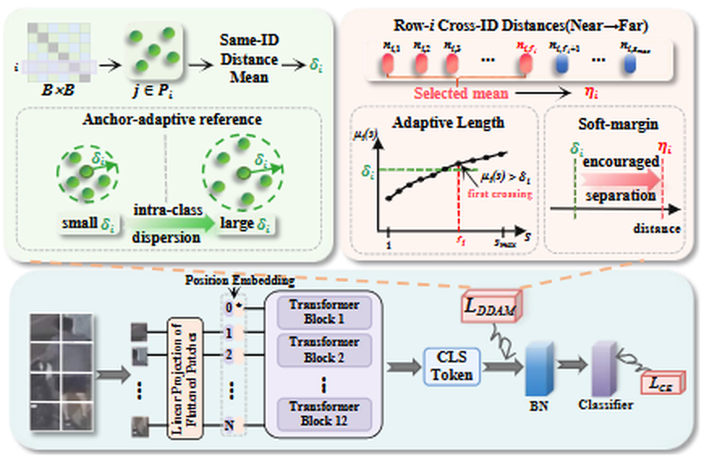
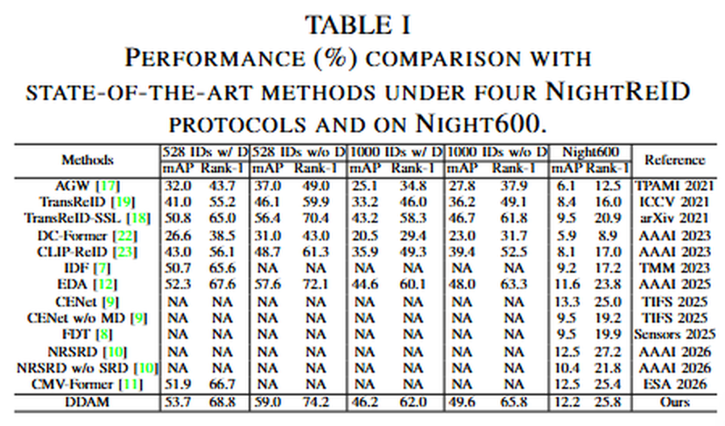
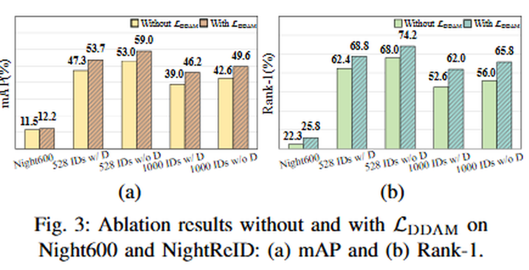
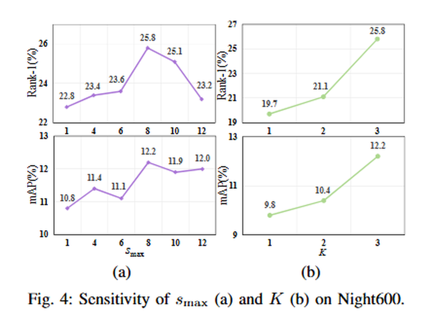
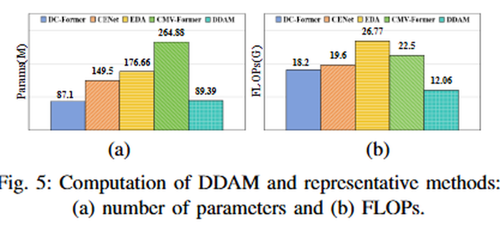
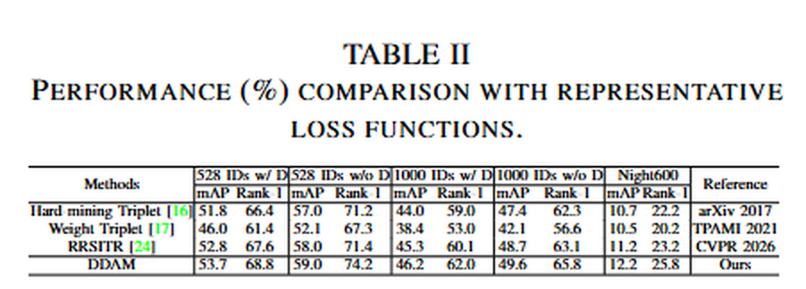
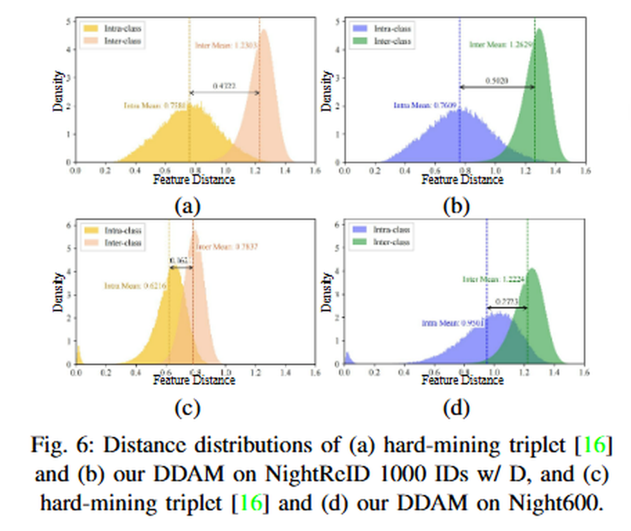

# DDAM: Dynamic Difficulty-Aware Mining for RGB-Based Low-Light Person Re-Identification


PyTorch implementation of **Dynamic Difficulty-Aware Mining for RGB-Based Low-Light Person Re-Identification**.

## Updates

- **(2026-11-13)** Released the training code, configurations, result figures, and feature artifacts.

## Highlights

Low-light noise and visual distortion make same-identity and different-identity samples difficult to separate. We propose **dynamic difficulty-aware mining (DDAM)**, a relation-conditioned metric-learning method that adapts negative participation to each anchor. DDAM first estimates anchor difficulty from valid same-identity samples. It then sorts the cross-identity distances and dynamically selects a compact set of negatives according to the anchor-specific difficulty reference. Ambiguous anchors receive broader negative supervision, while more discriminative anchors focus on fewer informative negatives.

DDAM is applied only to the training objective. It keeps the single-branch TransReID-SSL backbone, requires no additional training data, and introduces no extra inference branch.

<p align="center">
  
</p>

<p align="center"><b>Figure 2.</b> Overview of the DDAM-based person re-identification framework. The upper part illustrates anchor-specific difficulty estimation and dynamic ordered-negative selection; the lower part shows its integration with the single-branch Transformer backbone.</p>

## Usage

### Requirements

The experiments use Python 3.8, PyTorch 1.8.2, torchvision 0.9.2, and CUDA 11.1. Linux with an NVIDIA GPU is recommended.

```bash
conda create -n ddam python=3.8 -y
conda activate ddam

pip install torch==1.8.2+cu111 torchvision==0.9.2+cu111 \
  -f https://download.pytorch.org/whl/torch_stable.html
pip install numpy==1.26.4 scipy==1.13.1 scikit-learn==1.6.1 \
  matplotlib==3.9.4 Pillow==9.3.0 PyYAML==6.0.2 yacs==0.1.8 \
  timm==1.0.15 tqdm==4.67.1
```

The provided `requirements.txt` is an environment snapshot and contains several machine-local Conda paths. Replace those entries before installing it on another machine.

### Prepare Datasets

Download the datasets from their original providers:

- [NightReID](https://github.com/msm8976/NightReID)
- [Night600](https://github.com/Alexadlu/IDF)

| Dataset | Identities | Cameras | Images | Evaluation setting |
|---|---:|---:|---:|---|
| NightReID | 1,500 labeled + 1,096 distractor IDs | 6 | 53,239 | 528/1,000 IDs, with or without distractors |
| Night600 | 600 | 8 | 28,813 | Standard query/gallery protocol |

Organize the datasets as follows:

```text
your_dataset_root/
├── NightReID/
│   ├── bounding_box_train/
│   ├── query/
│   ├── query-1000/
│   ├── bounding_box_test/
│   ├── bounding_box_test-528-noDistractors/
│   ├── bounding_box_test_withDistractors/
│   └── bounding_box_test-1000-noDistractors/
└── night600/
    ├── bounding_box_train/
    ├── query_3/
    └── bounding_box_test/
```

Set `DATASETS.ROOT_DIR` in the corresponding YAML configuration to `your_dataset_root`.

### Pretrained Backbone

DDAM uses the ViT-B/16+ICS pretrained backbone from [TransReID-SSL](https://github.com/damo-cv/TransReID-SSL). The expected file is:

```text
vit_base_ics_cfs_lup.pth
```

The file and released feature artifacts are managed through Git LFS:

```bash
git lfs install
git lfs pull
```

### Training

> **Release note:** the current Git snapshot does not track the `datasets/` and `model/` packages imported by the entry scripts. Add them from the complete release package before running end-to-end training or testing.

```bash
# NightReID
python train.py \
  --config_file configs/nightreid/DDAM.yml \
  DATASETS.ROOT_DIR /path/to/your_dataset_root

# Night600
python train.py \
  --config_file configs/night600/DDAM.yml \
  MODEL.APS 3 \
  DATASETS.ROOT_DIR /path/to/your_dataset_root
```

`MODEL.APS 3` matches the Night600 setting used in the paper and the released DDAM loss.

### Testing

```bash
# NightReID
python test.py \
  --config_file configs/nightreid/DDAM.yml \
  DATASETS.ROOT_DIR /path/to/your_dataset_root \
  TEST.WEIGHT /path/to/transformer_best_mAP.pth

# Night600
python test.py \
  --config_file configs/night600/DDAM.yml \
  MODEL.APS 3 \
  DATASETS.ROOT_DIR /path/to/your_dataset_root \
  TEST.WEIGHT /path/to/transformer_best_mAP.pth
```

## Results

### Table 1: Comparison with State-of-the-Art Methods

Results are reported using mAP and Rank-1 accuracy. `w/ D` and `w/o D` denote evaluation with and without distractor identities.

<p align="center">
  
</p>

DDAM achieves **53.7% mAP / 68.8% Rank-1** on NightReID 528 IDs with distractors and **12.2% mAP / 25.8% Rank-1** on Night600.

### Figure 3: Ablation Study

<p align="center">
  
</p>

Adding the DDAM objective consistently improves mAP and Rank-1 on Night600 and all four NightReID protocols.

### Figure 4: Hyperparameter Analysis

<p align="center">
  
</p>

Sensitivity analysis of the maximum negative participation length and the number of farthest same-identity samples on Night600.

### Figure 5: Model Complexity

<p align="center">
  
</p>

DDAM retains a single-branch architecture and applies its mining strategy only during training.

### Table 2: Comparison with Representative Loss Functions

<p align="center">
  
</p>

DDAM outperforms hard-mining triplet, weighted triplet, and RRSITR on both NightReID and Night600.

### Figure 6: Feature Distance Distributions

<p align="center">
  
</p>

DDAM produces clearer separation between intra-class and inter-class distance distributions on both datasets.

## Released Feature Artifacts

- `outputs/night600/`: DDAM, hard-mining triplet, and no-DDAM baseline features.
- `outputs/nightreid_4protocols/`: DDAM and hard-mining triplet features for all four NightReID protocols.

## Citation

If this project is useful in your research, please cite:

```bibtex
@misc{wen2026ddam,
  title  = {Dynamic Difficulty-Aware Mining for RGB-Based Low-Light Person Re-Identification},
  author = {Y. T. Wen and W. J. Xiang and H. Zhang and X. X. Zhu and H. S. Liu and H. Q. Zeng and J. Q. Zhu},
  year   = {2026},
  note   = {Manuscript}
}
```

## Acknowledgements

This repository is developed from the [NightReID/EDA](https://github.com/msm8976/NightReID) codebase, which follows [TransReID](https://github.com/damo-cv/TransReID) and [reid-strong-baseline](https://github.com/michuanhaohao/reid-strong-baseline). We use the [TransReID-SSL](https://github.com/damo-cv/TransReID-SSL) pretrained backbone and evaluate on [NightReID](https://github.com/msm8976/NightReID) and [Night600/IDF](https://github.com/Alexadlu/IDF). Optional reference utilities retained in the repository credit [AdaSP](https://github.com/Astaxanthin/AdaSP), [Proxy-NCA](https://github.com/dichotomies/proxy-nca), and [person-re-ranking](https://github.com/zhunzhong07/person-re-ranking); they are not used in the main DDAM experiments.
